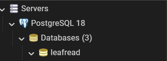
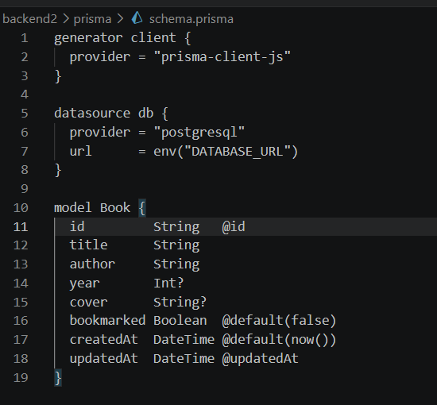
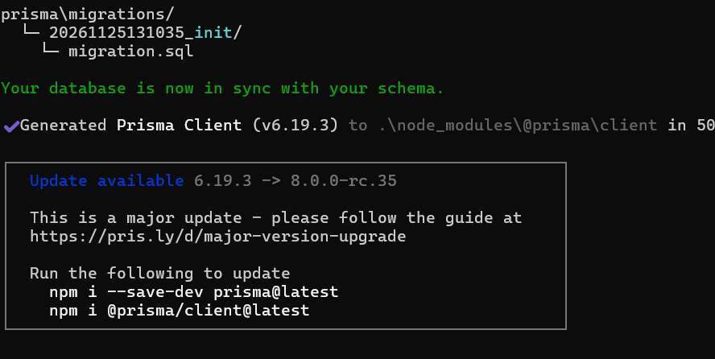
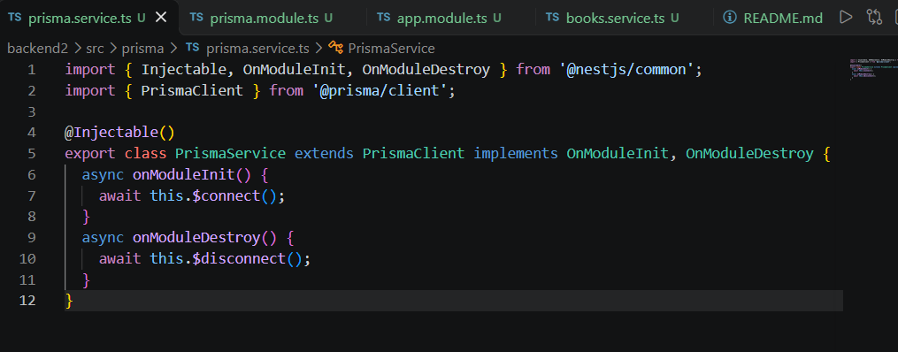
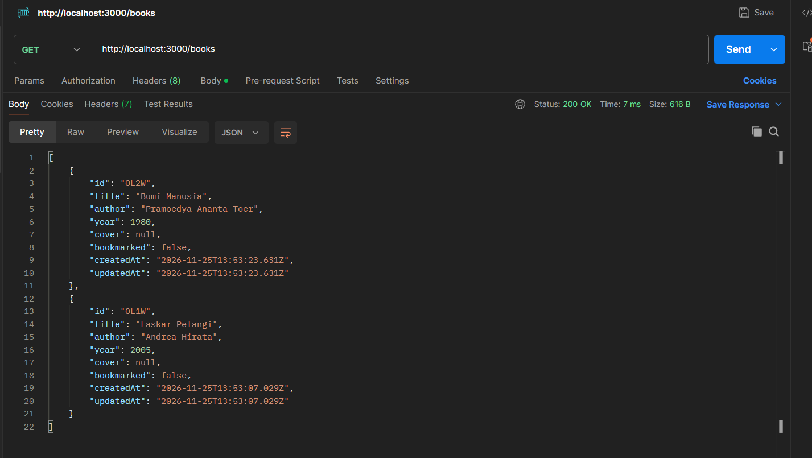
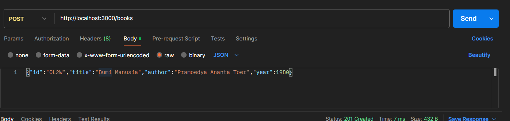
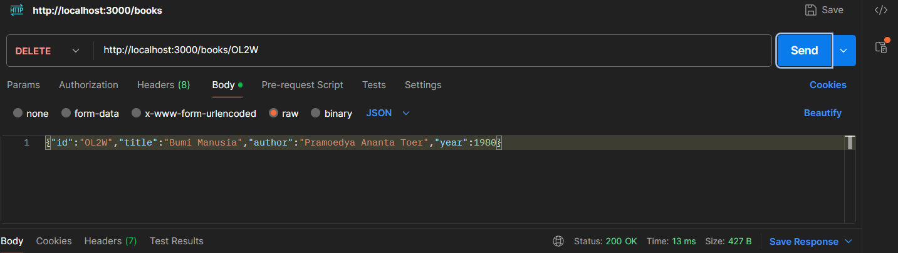
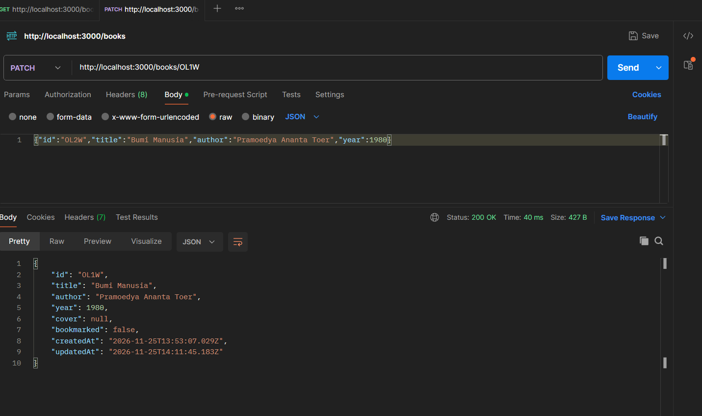

# LeafRead
Aplikasi perpustakaan pribadi: cari buku lewat Open Library, simpan ke koleksi,
dan beri bookmark. Backend NestJS + Prisma + PostgreSQL.

## Cara Menjalankan
1. Buat database `leafread` di PostgreSQL
2. Salin `.env.example` jadi `.env`, isi `DATABASE_URL`
3. `npm install` → `npx prisma migrate dev` → `npm run start:dev`

## Endpoint
GET/POST /books, GET/PATCH/DELETE /books/:id, GET /books/stats, GET /books/bookmarked

## Screenshot
1. Siapkan server PostgreSQL lokal dan buat basis data untuk aplikasi Anda.  
   

2. Rancang model Prisma (`schema.prisma`) sesuai entitas utama pada aplikasi Anda sendiri.  
   

3. Jalankan migrasi awal (`npx prisma migrate dev`) dan pastikan tabel berhasil terbentuk di basis data.  
   

4. Buat `PrismaService` sebagai provider, lalu hubungkan ke service REST API Anda untuk menggantikan penyimpanan array yang dipakai sejak Pekan 9, tanpa mengubah kode controller.  
   

5. Pastikan operasi CRUD dasar (create, read, update, delete) pada aplikasi Anda sudah berjalan menggunakan Prisma Client dan tersimpan permanen.

   

   .png)

   

   

   

6. (Opsional, nilai tambah) Tambahkan 1 endpoint dengan query lanjutan, misalnya filter data (`where`) atau statistik sederhana (`count`).  
   